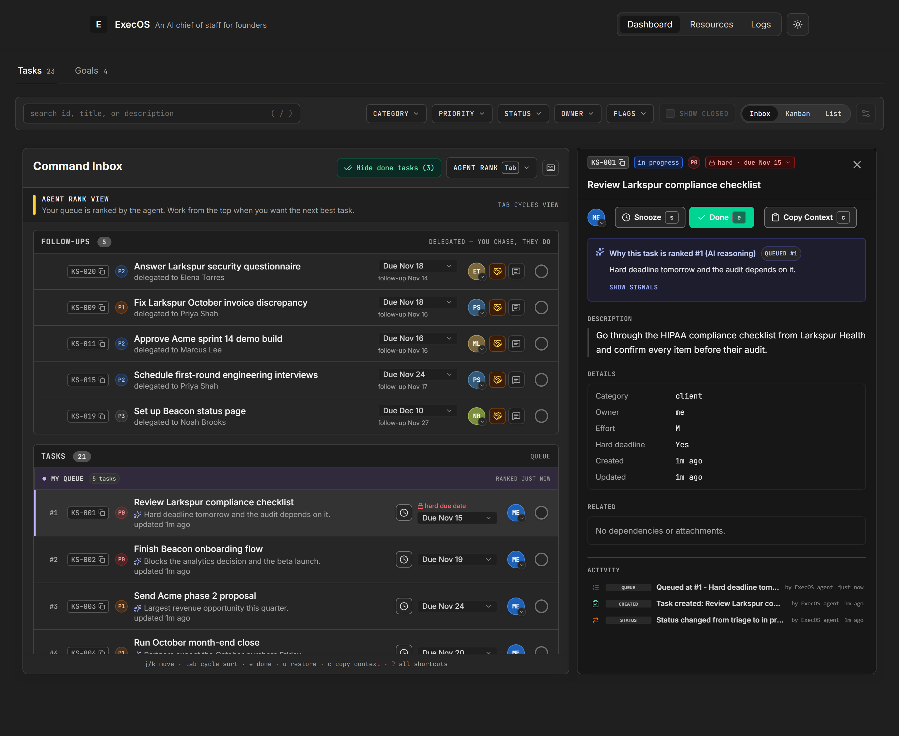
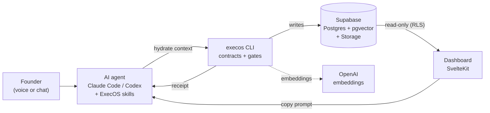
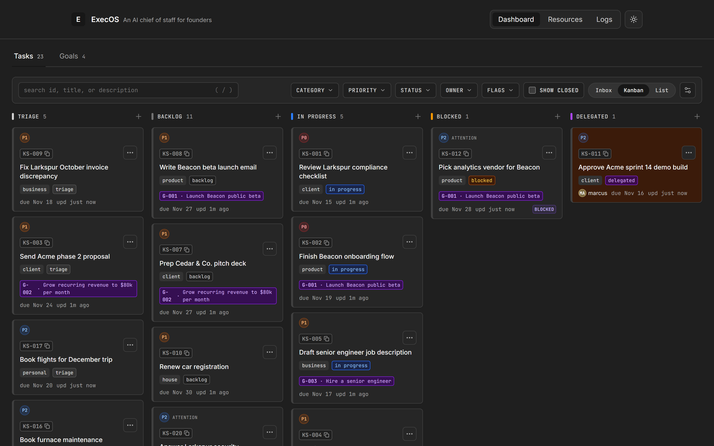
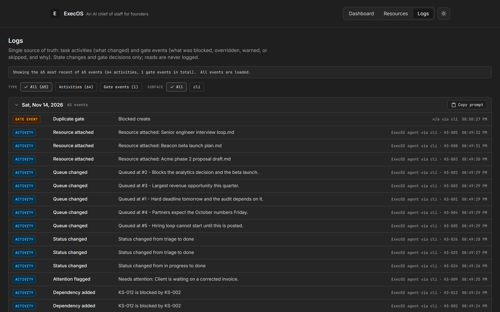
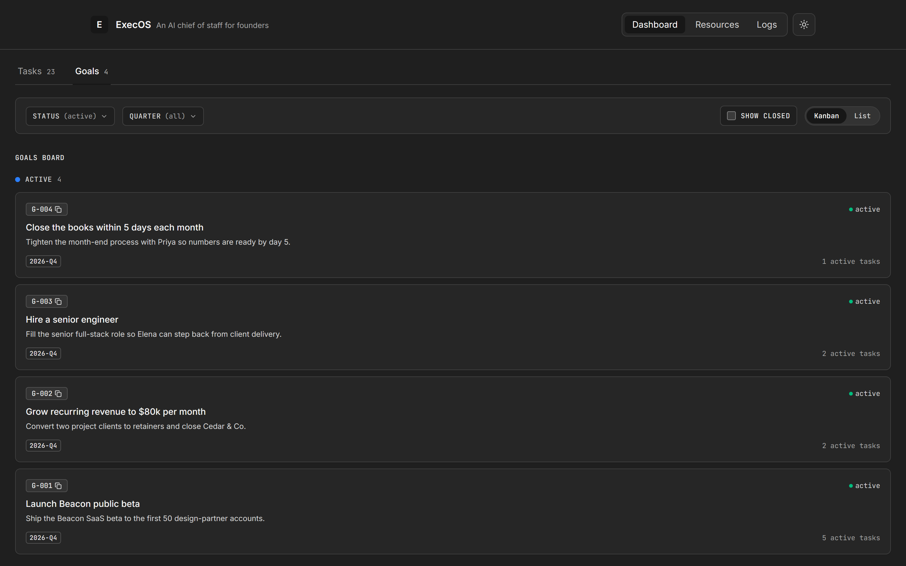
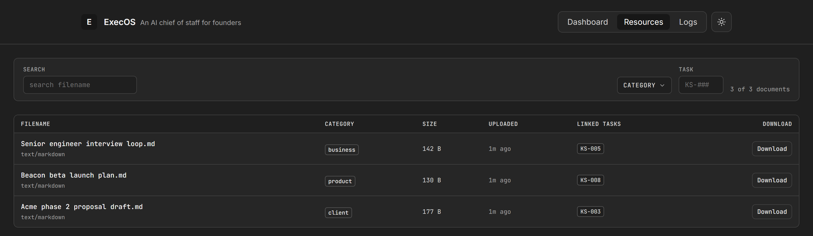
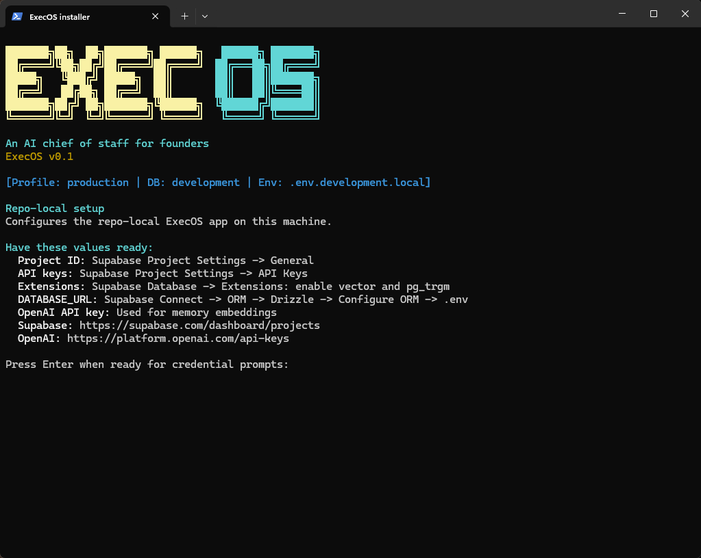

# ExecOS

**An AI chief of staff for founders.**

ExecOS is an agentic operating system for a founder's workload. You don't open
a task app; you talk to an AI agent (Claude Code or Codex), and it captures,
prioritizes, delegates, follows up, files documents, and runs your reviews.
Every action the agent takes goes through a typed CLI that enforces the rules,
and a local dashboard gives you a read-only window into the whole system.

It was designed and built for a real CEO juggling client delivery, a SaaS
product, and personal life, mostly by voice. This repository is the open-source
version with fictional demo data.

> [!NOTE]
> All names, companies, and tasks in the demo data and test fixtures are fictional.
> The agent prompts, skills, and some CLI messages are written for one fictional
> founder, Jordan Avery of Northwind Studio. To run ExecOS for yourself, see
> [Make it yours](#make-it-yours).



---

## Why it is more than a task app

Most AI agents are demos: they can act, but nothing stops them from making a
mess. ExecOS is built around the opposite idea. The agent is the interface,
but it never touches the database directly.

| Layer | What it is | What it does |
| --- | --- | --- |
| **Conversation** | Claude Code or Codex, plus 14 production agent skills | Turns plain speech ("Larkspur needs the corrected invoice by Friday, have Priya handle it") into structured operations: intake, prioritization, delegation, follow-ups, reviews, document filing, and memory. |
| **Operations** | The `execos` TypeScript CLI, the only write path | Enforces the rules: semantic duplicate detection with embeddings, a hard cap on P0 work, explicit-only priorities, required due dates, and an append-only audit log of every change and every guardrail decision. |
| **View** | A local SvelteKit dashboard | Agent-ranked inbox, Kanban, goals, documents, and the full activity log. It is read-only: its action buttons generate prompts for the agent, so even the UI goes through the guardrails. |



### How a request flows

1. **Hydrate.** The agent asks the CLI for a context packet for the operation
   (`execos taskops hydrate --operation create ...`): candidate duplicates, the
   active queue, goals, team roster, and the rules that apply.
2. **Act.** The agent runs one contract-governed operation (`create`, `update`,
   `delegate`, `complete`, `re-rank`, ...). Each operation is defined in
   [`OperationalContracts/taskops/contract.yaml`](OperationalContracts/taskops/contract.yaml)
   with its own hydrate and receipt templates.
3. **Gate.** The CLI enforces the guardrails. A near-duplicate is refused unless
   the agent overrides it with a written justification; promoting a fourth P0
   is blocked with explicit options; terminal statuses need confirmation.
4. **Receipt.** The CLI returns a structured receipt the agent relays back, and
   both the change and any gate decision land in the audit log the dashboard
   shows.

---

## Screenshots

**Kanban board.** Every task with its priority, category, status, and goal link.



**Audit log.** Every change and every guardrail decision. Here the duplicate gate blocked the agent from re-creating an existing task.



**Quarterly goals.** Goals are first-class records that tasks link to.



**Documents.** Files in private storage, linked to tasks, downloaded through short-lived signed URLs.



**Installer.** A guided setup that validates every credential before writing anything.



---

## Features

- **Natural-language intake** with a six-step checklist: dedup, complexity
  split, dependency detection, field inference, delegation, downstream impact.
- **Semantic duplicate detection** using OpenAI embeddings in pgvector, banded
  into exact, near-identical, and similar matches, with audited overrides.
- **Tier-first prioritization**: P0 to P3 commitments, hard versus soft
  deadlines, goal alignment, and an agent-locked "do next" queue.
- **Delegation and follow-ups**: hand work to a teammate, set a follow-up date,
  and have it resurface as something to chase, not something to do.
- **Reviews**: morning, end of day, weekly, and quarterly goal reviews.
- **Documents**: upload files to private Supabase Storage, link them to tasks,
  and download them through short-lived signed URLs.
- **Memory**: scoped, versioned memories (preferences, policies, people context)
  with semantic recall and a supersede flow instead of silent overwrites.
- **Agent profiles**: production and developer prompt and skill sets,
  materialized for Claude Code, Codex, and Gemini from one source of truth.
- **Installer for Windows and Linux (including WSL)** with credential
  validation, migrations with pre-migration backups, and a sandbox mode that
  clones production-shaped data into a local stack.

## Engineering

- **About 33k lines of TypeScript and Svelte**, plus 23k lines of tests.
- **935 fast tests** (Vitest), plus separate database and migration suites
  that run against a disposable local Supabase stack.
- **Enforced architecture.** Rules are ratified in
  [`architecture/constitution.md`](architecture/constitution.md), each one
  names the check that enforces it, and `npm run arch:check` (dependency-cruiser
  plus architecture tests) runs in CI on every push.
- **Append-only audit trail.** Task notes and activities are never updated in
  place; all writes go through a single funnel.
- **Least privilege.** The dashboard reads with the anon key under Row Level
  Security and performs no database writes; only the CLI holds the service key.

## Tech stack

TypeScript, Node.js 20+, Commander, SvelteKit 2 with Svelte 5, Tailwind CSS,
Supabase (Postgres 17, pgvector, Storage), Drizzle ORM, OpenAI embeddings,
Vitest, dependency-cruiser, Claude Code and Codex.

---

## Run the demo locally

You need Node.js 20+, Docker, and the Supabase CLI (run through `npx`).

```bash
git clone https://github.com/calvinl345/execos.git
cd execos
npm ci
npx supabase start
```

Create `.env.development.local` from `.env.example` and fill it in with the
values `npx supabase status` prints (API URL, service role key, anon key, and
the database URL). For a demo without an OpenAI key, add:

```bash
EXECOS_DB_ENV=development
EXECOS_TEST_EMBEDDINGS=1
EXECOS_DEMO_MODE=1
```

Then load the fictional demo data and open the dashboard:

```bash
npm run target:dev
npm run demo:reset
npm run execos -- dashboard start
```

`demo:reset` refuses to run unless `.env.development.local` points at a local
database. It wipes the local stack, applies migrations, and seeds 26 tasks,
4 goals, a team, and 3 documents through the real CLI.

To try the agent side, open Claude Code or Codex in the repo folder after
running the installer (`scripts/install.ps1` or `scripts/install.sh`), which
publishes the `execos` command and materializes the agent prompts and skills.
Then just talk to it: "What should I work on?", "Add a task to send the Acme
proposal Friday", "Run my weekly review".

## Make it yours

ExecOS ships as a reference implementation with a demo persona, so the agent
addresses the user as Jordan until you change it. Before using it for your own
work, edit the source files under `Profiles/` and rerun the installer, which
materializes them for your agent:

- **Who you are.** Replace the "About Jordan" section and the name, company,
  and product spellings in `Profiles/Production/System Prompts/` (`AGENTS.md`
  and `CLAUDE.md`), and the persona's name in the skills and in
  `OperationalContracts/taskops/templates/`.
- **Your team.** Edit
  `Profiles/Production/Skills/team-delegation-prod/references/team-roster.md`.
- **Your working habits.** The prompts assume a biweekly leadership meeting
  (called L10), voice dictation, and a Notion decision log whose data source ID
  is a placeholder. Remove or adapt those sections.
- **Where bug reports go.** The `report-issue-prod` skill files GitHub issues
  against the checkout's git remote and falls back to this repository; change
  the fallback to your own fork.

Task IDs use the prefix `KS`. It is a setting (`infrastructure.task_id_prefix`),
but dependency detection in `src/domain/intake.ts` still matches `KS-`
literally, so change both together.

## Repository layout

| Path | Contents |
| --- | --- |
| `src/cli/` | The `execos` CLI: commands, contracts, and gates |
| `src/domain/`, `src/services/` | Prioritization, intake, delegation, and review logic |
| `src/db/` | Drizzle schema, migrations, and append-only helpers |
| `src/web/` | The SvelteKit dashboard |
| `OperationalContracts/` | The taskops contract and its hydrate and receipt templates |
| `Profiles/` | Agent system prompts and skills (production and developer) |
| `architecture/` | Constitution, decision records, and the command registry |
| `scripts/` | Installer, updater, launcher, sandbox, and demo tooling |
| `tests/` | Unit, contract, CLI, web, installer, and database suites |

## Development

```bash
npm run typecheck
npm run lint
npm test
npm run arch:check
npm run check:web
```

The full install, update, profile, and production-rollout guide from the
original deployment lives in [`docs/operations-guide.md`](docs/operations-guide.md).

## License

[MIT](LICENSE) © 2026 Calvin Smith
